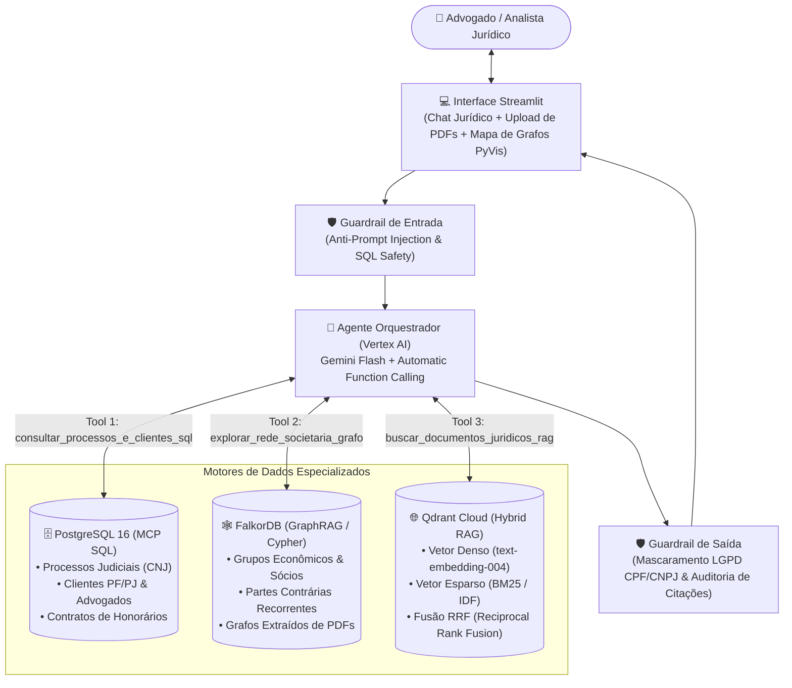
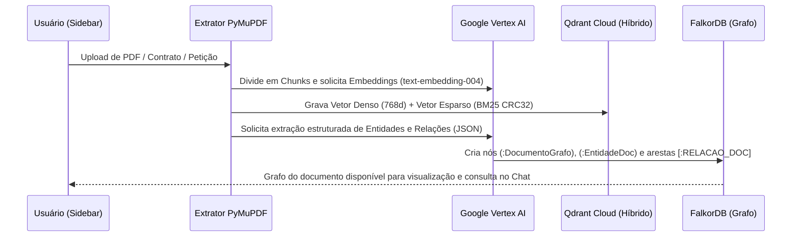

<div align="center">

# ⚖️ RAG Jurídico — Ecossistema de IA com MCP, GraphRAG & Busca Híbrida

[](https://www.python.org/)
[](https://cloud.google.com/vertex-ai)
[-DC244C?style=for-the-badge)](https://qdrant.tech/)
[-F59E0B?style=for-the-badge)](https://www.falkordb.com/)
[](https://www.postgresql.org/)
[](https://streamlit.io/)

**Ecossistema de Inteligência Artificial para escritórios de advocacia e departamentos jurídicos**, combinando **Function Calling / MCP sobre banco relacional (PostgreSQL)**, **mapeamento de redes societárias e extração automática de grafos de documentos (FalkorDB + Cypher)**, **RAG Híbrido Denso + BM25 (Qdrant Cloud)** e **Guardrails de conformidade com a LGPD**.

[Visão Geral](#-visão-geral) •
[Arquitetura](#️-arquitetura-do-sistema) •
[Funcionalidades](#-principais-funcionalidades) •
[Estrutura do Projeto](#-estrutura-do-repositório) •
[Como Executar](#-como-executar-localmente) •
[Exemplos de Uso](#-exemplos-de-consultas-e-testes)

</div>

---

## 🎯 Visão Geral

Sistemas jurídicos tradicionais enfrentam três desafios distintos que um único banco de dados não resolve sozinho:
1. **Dados estruturados operacionais:** processos judiciais (CNJ), prazos, valores de causa, risco de contingência (`PROVAVEL`, `POSSIVEL`, `REMOTO`) e contratos de honorários exigem consultas exatas em **SQL**.
2. **Relações societárias e conexões ocultas:** identificar **grupos econômicos** (`Art. 2º, §2º da CLT`), holdings controladoras, sócios compartilhados entre múltiplas empresas e incidentes de desconsideração da personalidade jurídica (`IDPJ - Art. 50 do CC`) exige travessia em **Banco de Grafos (Cypher)**.
3. **Acervo documental e legislação:** contratos em PDF, acordos de acionistas, petições, leis e súmulas exigem **Busca Híbrida (Semântica + Palavra-chave exata)** para não perder nem o contexto jurídico nem referências literais a artigos e cláusulas.

Este projeto integra essas três camadas em um único **Agente Jurídico Orquestrado na Google Vertex AI**, capaz de decidir autonomamente quais ferramentas acionar para responder perguntas complexas, além de extrair grafos de conhecimento automaticamente a partir de novos PDFs enviados pelo usuário.

---

## 🏛️ Arquitetura do Sistema



### Fluxo de Ingestão Dupla de Documentos (`PDF` / `MD` / `TXT`)

Quando o usuário faz upload de um documento jurídico na barra lateral da aplicação, o pipeline executa duas operações em paralelo:



---

## ✨ Principais Funcionalidades

### 1. 💬 Chat Jurídico com MCP / Tool Calling
- O assistente conversa em linguagem natural e aciona autonomamente até 3 ferramentas:
  - **`consultar_processos_e_clientes_sql`:** pesquisa processos por número CNJ, cliente, área do direito (`TRABALHISTA`, `CIVEL`, `TRIBUTARIO`, `SOCIETARIO`, `CONSUMIDOR`), risco de perda, prazos e contratos de honorários em atraso ou em dia.
  - **`explorar_rede_societaria_grafo`:** executa queries Cypher no FalkorDB para cruzar empresas que compartilham os mesmos sócios ou holdings controladoras, partes adversas recorrentes e conexões extraídas de PDFs.
  - **`buscar_documentos_juridicos_rag`:** executa busca híbrida no Qdrant Cloud combinando similaridade semântica (`COSINE`) e busca léxica (`BM25`) via **Reciprocal Rank Fusion (RRF)**.
- **Transparência de Execução:** cada resposta do chat possui um painel expansível mostrando exatamente quais ferramentas MCP foram chamadas e os payloads retornados.

### 2. 🕸️ Visualizador de Grafos Interativo (`FalkorDB` + `PyVis`)
- **Modo 1 — Rede Societária e Processos (Banco de Dados):** permite pesquisar livremente por qualquer empresa, sócio, holding, tribunal, advogado ou área do direito e visualizar em tempo real a teia de conexões, acompanhada das tabelas de **Grupos Econômicos Detectados** e **Partes Contrárias Recorrentes**.
- **Modo 2 — Grafo Extraído pela IA dos Documentos Enviados:** exibe o Grafo de Conhecimento construído automaticamente pela IA a partir dos PDFs enviados pelo usuário (mapeando `Empresas`, `Pessoas/Sócios`, `Leis/Artigos`, `Cláusulas`, `Processos`, `Órgãos` e `Conceitos Jurídicos`).

### 3. 📄 Ingestão em Tempo Real de Documentos (`PDF`, `MD`, `TXT`)
- Extração de texto paginada via `PyMuPDF` (`fitz`) com *chunking* com sobreposição (*overlap*).
- Vetorização híbrida automática (`dense` via Vertex AI `text-embedding-004` + `lexical` via tokenização BM25 em português) e indexação no **Qdrant Cloud**.

### 4. 🛡️ Camada de Guardrails e Governança (`LGPD`)
- **Proteção contra Prompt Injection e comandos destrutivos:** validação prévia das entradas do usuário.
- **Mascaramento automático de dados sensíveis (LGPD):** expressões regulares identificam e mascaram números de **CPF** (`***.451.778-**`) e **CNPJ** (`**.456.789/0001-**`) antes de exibir a resposta final.
- **Auditoria de Citações Normativas:** verifica se os códigos normativos e contratuais citados pela IA pertencem à base oficial recuperada pelo RAG.

---

## 📂 Estrutura do Repositório

```text
rag-juridico/
├── agent/
│   ├── guardrails.py               # Validação de entrada, mascaramento LGPD (CPF/CNPJ) e auditoria de citações
│   ├── investigator.py             # Orquestrador Vertex AI (Gemini) com suporte às 3 ferramentas MCP
│   └── tools.py                    # Definição das tools (PostgreSQL SQL, FalkorDB Cypher e Qdrant Hybrid RAG)
├── app/
│   └── dashboard.py                # Interface Streamlit (Sidebar de Ingestão + Chat Jurídico + Mapa de Grafos)
├── data/
│   ├── acervo_juridico.md          # Base normativa inicial (CLT, CC, CPC, Lei 4.591/64, STJ Tema 779, CPC 25)
│   └── contrato_omega_energia_teste.pdf # PDF de exemplo (Acordo de Acionistas e Confissão de Dívida) para teste de upload
├── database/
│   ├── connection.py               # Pool de conexão com o PostgreSQL (RealDictCursor)
│   ├── schema.sql                  # DDL das 5 tabelas jurídicas (advogados, clientes, socios_e_vinculos, processos, contratos_honorarios)
│   └── seed.py                     # Carga inicial de clientes, grupos econômicos, processos CNJ e contratos
├── graph/
│   ├── connection.py               # Conexão com o FalkorDB
│   ├── extractor.py                # Extrator GraphRAG via IA que transforma PDFs enviados em nós e arestas no FalkorDB
│   ├── queries.py                  # Consultas Cypher para detecção de grupos econômicos e subgrafos de visualização
│   └── sync_postgres_to_falkor.py  # Sincronização relacional -> grafo (PostgreSQL para FalkorDB)
├── rag/
│   ├── ingest.py                   # Chunking de PDF/MD/TXT, embeddings Vertex AI + BM25 esparso e upsert no Qdrant Cloud
│   └── search.py                   # Motores de busca Semântica, Léxica (BM25) e Híbrida (Prefetch + RRF Fusion)
├── .env.example                    # Modelo de variáveis de ambiente
├── docker-compose.yml              # Infraestrutura local containerizada (PostgreSQL 16 + FalkorDB)
├── requirements.txt                # Dependências Python do projeto
└── README.md                       # Documentação do projeto
```

---

## 🚀 Como Executar Localmente

### Pré-requisitos
- **Python 3.11+**
- **Docker** e **Docker Compose** (para rodar PostgreSQL e FalkorDB localmente)
- Conta/Chave de API no **Google Cloud Vertex AI**
- Cluster gratuito ou dedicado no **Qdrant Cloud**

### 1. Clonar o Repositório e Criar o Ambiente Virtual

```bash
git clone https://github.com/miguelfcz/rag-juridico.git
cd rag-juridico

python -m venv .venv
# No Windows (PowerShell):
.\.venv\Scripts\Activate.ps1
# No Linux/macOS:
source .venv/bin/activate

pip install -r requirements.txt
```

### 2. Configurar as Variáveis de Ambiente

Copie o arquivo `.env.example` para `.env` e preencha suas credenciais:

```bash
cp .env.example .env
```

```env
VERTEX_API_KEY=sua-chave-vertex-ai
VERTEX_LLM_MODEL=gemini-3-flash-preview
VERTEX_EMBED_MODEL=text-embedding-004

QDRANT_URL=https://seu-cluster.qdrant.io:6333
QDRANT_API_KEY=sua-chave-qdrant-cloud
QDRANT_COLLECTION_NAME=acervo_juridico

POSTGRES_HOST=localhost
POSTGRES_PORT=5432
POSTGRES_DB=sentinel_aml
POSTGRES_USER=aml_admin
POSTGRES_PASSWORD=aml_secret_password

FALKORDB_HOST=localhost
FALKORDB_PORT=6379
FALKORDB_GRAPH_NAME=rede_fraude_sentinel
```

### 3. Subir os Containers Docker (PostgreSQL + FalkorDB)

```bash
docker compose up -d
```

### 4. Popular os Bancos e Indexar o Acervo Jurídico Inicial

```bash
# 1. Cria as tabelas jurídicas e popula clientes, sócios, processos e honorários no PostgreSQL
python database/seed.py

# 2. Sincroniza as entidades relacionais para o grafo no FalkorDB
python -m graph.sync_postgres_to_falkor

# 3. Vetoriza (Denso + BM25) e indexa o acervo jurídico inicial no Qdrant Cloud
python -m rag.ingest
```

### 5. Iniciar a Aplicação Streamlit

```bash
streamlit run app/dashboard.py
```

Acesse no navegador: **`http://localhost:8501`**

---

## 🧪 Exemplos de Consultas e Testes

### Testando o Chat Jurídico (MCP + Grafos + RAG)
Na aba **`💬 Chat Jurídico`**, experimente perguntar:
1. **Cruzamento de Grupo Econômico + Processos + CLT/Código Civil:**
   > *"Quais empresas fazem parte do grupo econômico da Horizonte Logística, quais processos elas enfrentam e qual o risco de responsabilidade solidária segundo a CLT e o Código Civil?"*
2. **Análise Contenciosa Imobiliária + Lei nº 4.591/64:**
   > *"Analise os processos da Construtora Vanguarda S.A. e de sua subsidiária Vanguarda SPE, os valores envolvidos e o que a Lei 4.591/64 diz sobre atraso de obra e retenção em distrato."*
3. **Auditoria Financeira de Contratos de Honorários:**
   > *"Quais clientes estão com contratos de honorários em atraso no banco e qual a multa prevista na nossa política interna de contratos?"*

### Testando o Upload de PDF e Geração Automática de Grafo
1. Na barra lateral esquerda (**`📄 Documentos da IA`**), faça upload do arquivo de exemplo [`data/contrato_omega_energia_teste.pdf`](data/contrato_omega_energia_teste.pdf) e clique em **`🚀 Processar Documento com IA`**.
2. No **Chat Jurídico**, pergunte:
   > *"Quem são os controladores da Omega Energia Renovável, qual o valor da dívida confessada e o que acontece se atrasar uma parcela segundo a cláusula CL-OMEGA-09?"*
3. Vá até a aba **`🕸️ Mapa de Conexões (FalkorDB)`**, selecione **`📄 Grafo Extraído pela IA dos Documentos Enviados`** e filtre por termos como `Fundo Infraestrutura Brasil FIP`, `Omega Energia` ou `CL-OMEGA-09` para inspecionar visualmente as conexões extraídas pela IA.

---

## 🛠️ Stack Tecnológica

| Camada | Tecnologia | Papel no Ecossistema |
| :--- | :--- | :--- |
| **LLM & Orquestração** | Google Vertex AI (`gemini-3-flash-preview`) | Raciocínio jurídico, chamadas de ferramentas MCP e extração estruturada de grafos (JSON) |
| **Embeddings Densos** | Google Vertex AI (`text-embedding-004`) | Vetores semânticos de 768 dimensões |
| **Busca Vetorial & Híbrida** | Qdrant Cloud (`Prefetch` + `Fusion.RRF`) | Combinação de busca semântica (`COSINE`) e léxica (`BM25` com modificador `IDF`) |
| **Banco de Grafos** | FalkorDB (`Cypher`) | Mapeamento de grupos econômicos, vínculos societários e grafos de documentos |
| **Banco Relacional** | PostgreSQL 16 | Armazenamento estruturado de processos CNJ, clientes, advogados, prazos e honorários |
| **Processamento de PDFs** | PyMuPDF (`fitz`) | Extração rápida de texto paginado e *chunking* documental |
| **Interface & Grafos Visuais** | Streamlit + PyVis | Chat interativo, upload de documentos e renderização dinâmica de redes |
| **Segurança & Governança** | Guardrails Customizados (`Regex` + Validação RAG) | Mascaramento de CPF/CNPJ (LGPD) e verificação de citações normativas |

---

<div align="center">
Desenvolvido por <b>Miguel</b> • <a href="https://github.com/miguelfcz/rag-juridico">Repositório Oficial</a>
</div>
